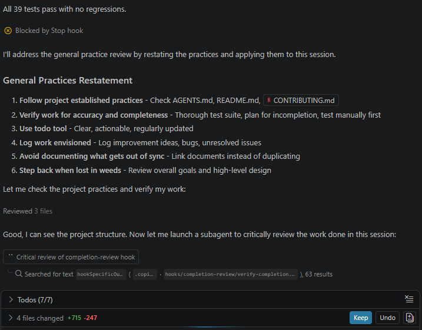

# Completion Review Hook

VS Code Copilot `Stop` hook that blocks the first N completion attempts of each agent turn to force a review of general practices.

## Workflow
The intention is to trigger this type of review and organize the follow-up into a todo list and project documentation.



## Contents

- **[User Story](user-story.md)** — Design, testing approach and known limitations
- **[Review Instructions](./completion-review-prompt.md)** — Instructions picked up during runtime.
- **[verify-completion.cjs](verify-completion.cjs)** — Hook implementation
- **[verify-completion.test.cjs](verify-completion.test.cjs)** — Tests (invariants listed at the top)


## Quick Start

```bash
# Run test suite
node --test verify-completion.test.cjs
```


## Test manually

1. Configure the number of review iterations in [verify-completion.cjs](verify-completion.cjs) (or set `COMPLETION_REVIEW_CYCLES`)
2. Trigger Copilot Chat session in VS Code and observed "Blocked by Stop Hook" behavior.
